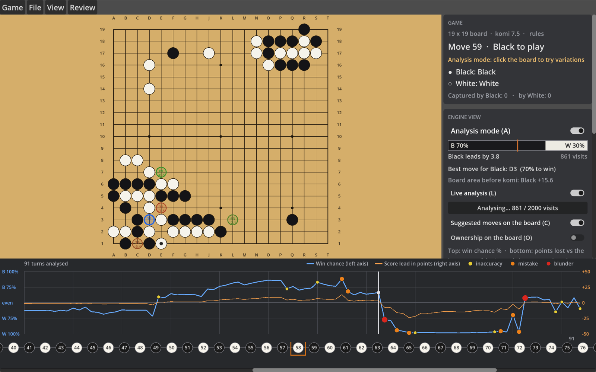

# go_game

A desktop Go app built with [Godot](https://godotengine.org) and [KataGo](https://github.com/lightvector/KataGo). Play against opponents that move like human players of a chosen rank, then review your games with KataGo's analysis.



## Features

- **Human-like opponents** from beginner (below 20k) up to 9d. They use KataGo's human SL network, so they make the kind of mistakes real players of that rank make. You can pick a modern style or a pre-AI style.
- **Full-game review**: the engine analyses every move. You get a win-rate and score graph, a list of each player's inaccuracies, mistakes and blunders, and you can click any point on the graph to jump there.
- **Live analysis** of the position on the board:
  - suggested moves, with win chance and score shown on each
  - hover over a suggestion to see the rest of its variation
  - an ownership overlay showing who controls each area
- **Variations**: click the board in analysis mode to try moves. A move tree shows every branch, and you can add a comment to any position.
- **SGF** files: open and save them, or drag one onto the window. Properties the app doesn't use are kept as they are. Finished games are saved automatically.
- 9×9, 13×13 and 19×19 boards; handicap games; Japanese and Chinese rules.
- No analysis is shown during a game unless you turn hints on.

## Getting started

You need three things: Godot, the KataGo engine and two KataGo networks. None of them are in this repository.

1. **Godot 4.5 or later** (standard build, not .NET): <https://godotengine.org/download>
2. **KataGo 1.18 or later**:
   - macOS: `brew install katago`
   - Windows: get the OpenCL build from the [KataGo releases](https://github.com/lightvector/KataGo/releases) page and put `katago.exe` and its DLLs in `engine/win/`
   - Linux: put the `katago` binary in `engine/linux/`
3. **Two networks**, in `engine/models/`:
   - `main.bin.gz`: a `kata1-b18c384nbt` network from <https://katagotraining.org/networks/>
   - `human.bin.gz`: `b18c384nbt-humanv0.bin.gz` from <https://katagotraining.org/extra_networks/>

`engine/analysis.cfg` is already included. You can regenerate it with `tools/make_analysis_cfg.py`.

Then open the project in Godot and press Run, or start it from the command line:

```bash
godot --path .
```

If the app can't find the engine or a network file, the Settings dialog tells you which file is missing. You can also set custom paths there.

Without the engine, the app still works for two players on one board and for opening and saving SGF files.

### macOS app

`tools/export_macos.sh` builds `build/macos/go_game.app`, with the networks and config inside the app. The KataGo binary itself still comes from Homebrew. This needs the Godot macOS export templates. To rebuild the app automatically after every commit, enable the hook with:

```bash
git config core.hooksPath .githooks
```

## Tests

The unit tests and UI smoke test don't need the engine:

```bash
godot --headless --path . --script tests/run_tests.gd
```

```bash
godot --headless --path . --script tests/smoke_ui.gd
```

The `tests/check_*.gd` scripts run the real KataGo engine (engine start-up, AI games, review, live analysis, crash recovery). Each takes a few minutes. If the engine files are missing, they print SKIP and exit cleanly.

`tests/render_check.gd` and `tests/render_graph.gd` save a screenshot of the board or the graph. `tools/pixel_assert.py` then checks that each stone and graph point was drawn at the right pixel. See [tools/README.md](tools/README.md) for these and the other helper scripts.

## Project layout

```
scripts/core/    rules, game tree, SGF, scoring, review (no UI, no engine)
scripts/engine/  KataGo process, analysis queries, the human-like opponent
scripts/ui/      board, graph, move tree, dialogs, main window
tests/           headless unit tests and engine-backed checks
testdata/        SGF files for the parser tests
tools/           helper scripts (export, match between levels, pixel checks)
engine/          analysis config; KataGo binaries and networks go here (gitignored)
docs/            KataGo analysis protocol notes, licences, match results
```

## License

The code in this repository is released under the [MIT License](LICENSE).

Third-party material:

- **KataGo** (engine and analysis protocol) © David J. Wu ("lightvector") and contributors, MIT License. `engine/analysis_example.cfg`, `docs/Analysis_Engine.md` and the SGF files in `testdata/` come from the KataGo repository. KataGo's license and contributor list are in [docs/licenses/](docs/licenses/).
- **KataGo networks** are not included. They are covered by the [KataGo network license](docs/licenses/katago-network-license.html); if you redistribute them, for example inside an exported app, include that license.
- **Godot Engine** is MIT licensed: <https://godotengine.org/license>.
